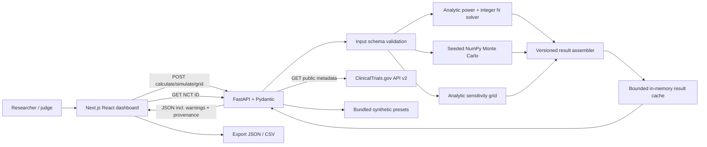

# Better Baseline — Infrastructure, Architecture & Interfaces

**Document:** `02_INFRASTRUCTURE_ARCHITECTURE.md`  
**Version:** 1.0, 10 October 2026  
**Companions:** [`01_BASELINE_BREAKER_SPEC.md`](01_BASELINE_BREAKER_SPEC.md) · [`03_IMPLEMENTATION_PLAYBOOK.md`](03_IMPLEMENTATION_PLAYBOOK.md)  
**Purpose:** give four developers an explicit deployment, repository, service, contract, data-flow, testing, and reliability design that can be implemented without extra architectural decisions.

## 1. Architectural decisions (ADR summary)

| ADR | Decision | Reason | Revisit when |
|---|---|---|---|
| A1 | **Next.js + TypeScript** client | Fast, familiar UI ecosystem; typed contracts | No need during hackathon |
| A2 | **Python FastAPI** statistics service | NumPy/statsmodels/SciPy integration | Real multitenant scaling |
| A3 | **No LLM in MVP** | Algorithm is the differentiator; avoids unsafe extracted values | Statistical core and demo already pass |
| A4 | **No database or authentication** | Presets, public NCT records, exports; no persistence required | Accounts or saved comparison history |
| A5 | **Use Cohen's h / NormalIndPower for canonical analytic power** | Defined, reproducible, easily validated reference | Biostatistical reviewer requests alternate primary test |
| A6 | **Pooled two-proportion z test in Monte Carlo** | Easy to simulate and verify | Rare-event or regulated methods needed |
| A7 | **Heatmap analytical first; Monte Carlo selected cell** | Low latency and manageable CPU requirements | Dedicated compute queue is available |
| A8 | **Immutable `planned_design`, mutable `stress_scenario`** | Prevents redefining enrollment while “shocking” assumptions | Always maintain separation |
| A9 | **Public data opt-in, nonblocking** | Offline demo and manual design must work without network | Later verified protocol parsing |
| A10 | **One small backend container** | 4-person 24-hour scope; little infrastructure overhead | Sustained multiuser CPU load |
| A11 | **Pin Python/JS dependencies at merge freeze** | Deterministic demo and numerical consistency | Routine maintenance |
| A12 | **Version statistical methods & exports** | Scientific traceability | Always retain |

## 2. End-to-end system diagram



**Dependency ordering:** shared schemas → statistical core → API → frontend data fetch; presets and client shell may proceed in parallel. CTG integration is *not* on the critical path.

### Workload separation

- **I/O-bound:** fetch ClinicalTrials.gov with an async HTTP client and a timeout.
- **CPU-bound:** power-grid evaluation and Monte Carlo on NumPy; do **not** assume `async` magically parallelizes CPU-heavy work. Put CPU endpoints in a synchronous FastAPI route or submit expensive work to a bounded worker thread/process with explicit concurrency caps.
- **Client:** chart transitions, controls, labels, and cached display; no statistical formulas duplicated as an authoritative implementation in React.

## 3. Technology inventory

| Category | Preferred | Alternative | Rationale |
|---|---|---|---|
| UI framework | Next.js App Router, React, TS | Vite React | Next.js already familiar; Vite if server features not used |
| Styling | Tailwind + accessible UI primitives | CSS modules | Rapid visual polish |
| Charts | Plotly.js / `react-plotly.js` via dynamic import | Recharts + custom heatmap | Interactive heatmap/contour |
| Data fetching | Native `fetch`, TanStack Query optional | SWR | Avoid refetch loops; request cancellation |
| API | FastAPI + Pydantic v2 | Flask | OpenAPI and data validation |
| Numerical | NumPy + SciPy | — | Binomial simulation, normal SF/CDF |
| Reference implementation | statsmodels | — | Independent sample-size and hypothesis-test checks |
| Data normalization | Python standard libs, Pandas optional | — | Keep metadata adapter small |
| HTTP | httpx | requests | API v2 public data |
| Tests | pytest, FastAPI TestClient, Playwright optional | Vitest | Statistical and E2E checks |
| Packaging | `uv`/`pip` with pinned lock | Poetry | Reproducibility |
| Deploy | Vercel UI + single Docker-backed Python service | Both in local Docker Compose | No managed DB, queue or secret store required |
| CI | GitHub Actions | Local scripts | Fast gate for 4 collaborators |

**Version policy:** prefer currently compatible stable versions at scaffold time, check the lockfile into Git, pin the exact image/runtime and library versions before demo freeze. Do not put unverified future library version numbers in infrastructure claims. The research references statsmodels 0.15 docs; runtime compatibility must be checked against the actually installed version.

## 4. Repository and work boundaries

```text
better-baseline/
├── frontend/
│   ├── app/
│   │   ├── page.tsx
│   │   └── layout.tsx
│   ├── components/
│   │   ├── DesignForm.tsx
│   │   ├── StressControls.tsx
│   │   ├── ScenarioComparator.tsx
│   │   ├── PowerCurve.tsx
│   │   ├── StressHeatmap.tsx
│   │   ├── ModelWarnings.tsx
│   │   └── NctImport.tsx
│   ├── lib/
│   │   ├── api.ts
│   │   ├── contracts.ts
│   │   ├── format.ts
│   │   └── presets.ts
│   ├── package.json
│   ├── package-lock.json
│   ├── next.config.ts
│   └── .env.example
├── backend/
│   ├── app/
│   │   ├── main.py
│   │   ├── schemas.py
│   │   ├── settings.py
│   │   ├── routers/
│   │   │   ├── calculations.py
│   │   │   ├── trials.py
│   │   │   └── health.py
│   │   ├── statistics/
│   │   │   ├── effect.py
│   │   │   ├── analytic.py
│   │   │   ├── sample_size.py
│   │   │   ├── simulation.py
│   │   │   ├── stress_grid.py
│   │   │   └── diagnostics.py
│   │   ├── data/
│   │   │   ├── clinicaltrials.py
│   │   │   ├── normalize.py
│   │   │   └── presets.py
│   │   └── cache.py
│   ├── tests/
│   │   ├── test_effect.py
│   │   ├── test_sample_size.py
│   │   ├── test_simulation.py
│   │   ├── test_grid.py
│   │   ├── test_api_contract.py
│   │   └── test_trial_adapter.py
│   ├── pyproject.toml
│   ├── uv.lock                  # or requirements lock, choose one
│   └── Dockerfile
├── contracts/
│   ├── api-v1.example.json
│   └── openapi.snapshot.json
├── demo-data/
│   ├── stable.json
│   ├── baseline-collapse.json
│   ├── attrition-shock.json
│   └── curated-study.json
├── docs/
│   ├── STATISTICAL_METHODS.md
│   ├── DEMO_SCRIPT.md
│   └── ASSUMPTION_PROVENANCE.md
├── .github/workflows/ci.yml
├── compose.yaml
└── README.md
```

**Task categories (not permanent owners):** A = backend/statistics and numerical checks; B = API/data/cache/deployment; C = frontend/charts; D = integration/contract checks/presets/demo. Assign or rotate categories according to the team's current workload. Coordinate edits to shared contracts and get cross-functional review; do not treat one category as the permanent owner of a contract.

## 5. Canonical API: shared type rules

All probability values are decimal fractions (`0.20`, **not** `20`). Enrollment counts are integers. No concealed defaults in POST bodies except optional values documented in schemas.

### 5.1 Shared domain type

```typescript
export type Effect =
  | { kind: "relative_risk"; value: number }
  | { kind: "absolute_risk_reduction"; value: number };

export interface TrialAssumptions {
  model_version: "binary-v1";
  control_event_rate: number; // 0 < pC < 1
  effect: Effect;             // RR 0..1 or valid ARR 0..pC
  alpha: number;             // 0 < alpha < 1
  target_power: number;      // 0 < target < 1
  allocation_ratio: number;  // MVP must be 1.0
  dropout: { control: number; treatment: number }; // [0,1)
}

export interface FixedEnrollment {
  control: number; // strict integer >= 1; equal to treatment in MVP
  treatment: number;
}

// Enrollment is positive. Expected retained counts are floored values and may be zero.
export interface ExpectedRetainedCounts {
  control: number; // strict integer >= 0; equal to treatment in MVP
  treatment: number;
}

export interface StressScenario {
  control_event_rate: number;
  dropout: { control: number; treatment: number };
  effect_override?: Effect | null;
}
```

**Validation:** reject invalid ARR stress points rather than auto-clipping. `model_version` is required. The supported MVP uses equal 1:1 enrollment and equal dropout rates between arms for both planned and stress scenarios; asymmetric arm counts or dropout are unsupported. Enrollment uses positive strict integers (`ArmCounts`); `ExpectedRetainedCounts` uses strict, equal nonnegative integers because floored expected retention may be zero. `allocation_ratio` must be `1.0`. A higher-is-better primary endpoint is unsupported.

### 5.2 `POST /api/v1/design/calculate`

Calculates a design from the **planned** assumptions. Request:

```json
{
  "model_version": "binary-v1",
  "control_event_rate": 0.2,
  "effect": {"kind": "relative_risk", "value": 0.75},
  "alpha": 0.05,
  "target_power": 0.8,
  "allocation_ratio": 1.0,
  "dropout": {"control": 0.1, "treatment": 0.1}
}
```

Example response, canonical arcsine method (sample estimates rounded at integer threshold):

```json
{
  "model_version": "binary-v1",
  "method": "cohen_h_normal_v1",
  "p_treatment": 0.15,
  "evaluable_n": {"control": 903, "treatment": 903},
  "enrolled_n": {"control": 1004, "treatment": 1004},
  "nominal_power_evaluable": 0.8,
  "warnings": ["Dropout inflation represents expected retention, not guaranteed evaluable counts."],
  "inputs_hash": "sha256:<generated-hash>"
}
```

The returned power is *at least* 0.80 at integer evaluable N, normally slightly above it; **compute the actual numeric return in the application**, do not hardcode the illustrative `0.8` in production.

### 5.3 `POST /api/v1/scenarios/evaluate`

Evaluates **fixed enrolled counts** against a different hypothetical true scenario.

```json
{
  "planned_design": {
    "model_version": "binary-v1",
    "control_event_rate": 0.2,
    "effect": {"kind": "relative_risk", "value": 0.75},
    "alpha": 0.05,
    "target_power": 0.8,
    "allocation_ratio": 1.0,
    "dropout": {"control": 0.1, "treatment": 0.1}
  },
  "fixed_enrollment": {"control": 1004, "treatment": 1004},
  "stress_scenario": {
    "control_event_rate": 0.1,
    "dropout": {"control": 0.1, "treatment": 0.1},
    "effect_override": null
  },
  "simulation": {"replicates": 10000, "seed": 42}
}
```

Response contract:

```json
{
  "model_version": "binary-v1",
  "analytic": {
    "method": "cohen_h_normal_v1",
    "conditional_power_approx": 0.47,
    "assumed_evaluable_n": {"control": 903, "treatment": 903}
  },
  "monte_carlo": {
    "method": "pooled_two_proportion_z_v1",
    "significant_two_sided_fraction": 0.47,
    "significant_favorable_fraction": 0.47,
    "mcse_two_sided": 0.005,
    "mcse_favorable": 0.005,
    "invalid_test_fraction": 0.0,
    "replicates": 10000,
    "seed": 42
  },
  "warnings": ["Illustrative independent dropout", "Analytic and Monte Carlo tests use distinct approximations"],
  "metadata": {"computed_at": "<server-generated ISO timestamp>", "inputs_hash": "<hash>"}
}
```

**Numbers in this JSON are schematic rounded illustrations, not reference assertions for seed 42.** The implementation must generate them. `assumed_evaluable_n` is a strict, equal, nonnegative integer count per arm computed by flooring expected retention; it is distinct from random retained counts in simulation. If it is zero, return `conditional_power_approx: null`, include a warning, and still run Monte Carlo. Never substitute fabricated zero analytic power. Statistical internals may expose additional diagnostics, but the API response uses only its declared fields and canonical names.

### 5.4 `POST /api/v1/scenarios/grid`

A deterministic **analytic** grid for fast heatmaps. Backend receives fixed planned N, effect, baseline limits, dropout limits, alpha, target. Bounds:

- baseline points ≤ 81, dropout points ≤ 61;
- individual probability values valid;
- two-dimensional `power` array indexed `[dropout_index][baseline_index]`;
- invalid model cells include `null` and an `invalid_mask` (never a fake zero-power value);
- cell values drawn from one named analytic approximation; stable ordering and size.

Response fields:

```text
model_version, method, x_baseline[], y_dropout[], power[][],
invalid_mask[][], target_power, planned_point, selected_point,
frontier_points[], contour_segments[], power_curve[], invalid_cell_count,
worst_case_power, warnings[], computed_at, inputs_hash
```

Use the selected effect by precedence: top-level `effect_override`, then `selected_scenario.effect_override`, then `planned_design.effect`. Conflicting explicit overrides are invalid. `selected_scenario` supplies the selected baseline/dropout point; its dropout also selects the power-curve slice, with 0.0 when omitted. For each grid cell use floored expected retained count `floor(enrolled_n × (1-d))` per arm and label the grid as an expected-count approximation. If the count is zero, that analytic cell is invalid (`null` plus mask); do not report zero power. The selected cell can receive the full Monte Carlo check. `contour_segments` follow the request's `target_power`; 80% is only the demo/default target. `worst_case_power` is the minimum among valid cells and is null iff there are none. No silent mixing of approximate and simulated grid values.

### 5.5 `GET /api/v1/trials/{nct_id}`

Public metadata import through server-side HTTP call to `https://clinicaltrials.gov/api/v2/studies/{NCT_ID}`. Strict validation `^NCT\d{8}$`; 5–10s timeout, bounded retry, cache. Return normalized optional fields and source information, not the entire upstream record.

```json
{
  "nct_id": "NCT01234567",
  "title": "<public title from record>",
  "study_type": "INTERVENTIONAL",
  "phase": "PHASE3",
  "allocation": "RANDOMIZED",
  "primary_outcomes": [
    {"measure": "<from study>", "time_frame": "<from study>"}
  ],
  "planned_control_event_rate": null,
  "planning_assumptions_source": "unavailable",
  "source_url": "https://clinicaltrials.gov/study/NCT01234567"
}
```

The NCT ID and text values above are placeholders, **not a validated example study**. Live optional fields must be represented as nullable; never fill missing data with guessed values.

### 5.6 Health, metadata, errors

```http
GET /healthz  -> {"status":"ok","model_version":"binary-v1"}
GET /api/v1/meta -> {"model_version":"binary-v1","methods":[...],"limits":{...}}
```

Error envelope:

```json
{
  "error": {
    "code": "INVALID_MODEL_INPUT",
    "message": "Treatment event probability would be negative for the selected ARR.",
    "field": "stress_scenario.control_event_rate",
    "recoverable": true
  }
}
```

Recommended status mapping: 422 invalid input, 404 unknown NCT, 429 compute quota, 502/504 external upstream error, 500 internal unexpected fault. Display human-readable errors in UI and log server exceptions internally without raw private request data.

### 5.7 Full reproducible export

`ExportPayload` is the canonical export shape. Serialize complete typed objects from the API schemas; do not replace them with presentation-only summaries or alternate export fields.

```json
{
  "export_schema_version": 1,
  "model_version": "binary-v1",
  "planned_design": {
    "model_version": "binary-v1",
    "control_event_rate": 0.2,
    "effect": {"kind": "relative_risk", "value": 0.75},
    "alpha": 0.05,
    "target_power": 0.8,
    "allocation_ratio": 1.0,
    "dropout": {"control": 0.0, "treatment": 0.0}
  },
  "fixed_enrollment": {"control": 903, "treatment": 903},
  "stress_scenario": null,
  "design_result": null,
  "evaluation_result": null,
  "grid_result": null,
  "software_versions": {"python": "3.12", "betterbaseline": "0.1.0"},
  "provenance": {
    "control_event_rate": {"source": "synthetic_preset", "description": "Baseline collapse preset"}
  },
  "exported_at": "2026-10-10T23:30:00Z"
}
```

`planned_design` and `fixed_enrollment` are required. Result and stress fields are nullable; non-null results use their canonical response models. Provenance values use the declared source tags. `software_versions` is a string-to-string map. `exported_at` is the export timestamp; calculation timestamps and hashes remain inside their typed result metadata where defined. Do not introduce alternate top-level `project`, `scenario_origin`, `source_links`, `generated_at`, or `inputs_hash` fields.

## 6. Data ingestion boundary & provenance

ClinicalTrials.gov API v2 commonly places key fields under:

```text
protocolSection.identificationModule
protocolSection.designModule
protocolSection.armsInterventionsModule
protocolSection.outcomesModule
protocolSection.eligibilityModule
resultsSection                        # only if results posted
```

The actual nesting/optional fields must be confirmed against a downloaded NCT fixture and official schema during implementation. Use Pydantic validation with optional fields and fixture tests. Expected control-arm endpoint *planning assumptions* often appear in protocol/SAP narrative documents rather than reliable first-class JSON fields.

**Provenance model:**

```json
{
  "field": "control_event_rate",
  "value": 0.2,
  "origin": "manual_user" ,
  "source_url": null,
  "source_location": null,
  "verified_by_user": true
}
```

Supported `origin`: `synthetic_preset`, `manual_user`, `protocol_curated`, `clinicaltrials_registry`. Neither code nor LLM may silently relabel `clinicaltrials_registry` observed event counts as `protocol_curated` expected risk.

**Storage:** keep three synthetic fixture JSON files in Git; optionally cache NCT metadata in process memory (LRU with TTL) or read a committed curated fixture. No database, object storage or patient tables needed.

## 7. Cache and compute controls

### Two-lane policy

1. **Fast lane:** deterministic analytic point and 30×25 grid; return quickly during slider movement.
2. **Refine lane:** NumPy vectorized 10k Monte Carlo selected scenario; trigger on slider release/debounce or explicit “Run simulation.”

Do not run 10k simulations per grid cell on each move. Prefer batching by scenario, return after bounded runtime, and guard public endpoints with a compute ceiling.

### Cache key

Canonical JSON serialization of inputs (including method version, random seed and replicates where relevant), hashed with SHA-256:

```python
cache_payload = json.dumps(
    {"route": route_name, "version": MODEL_VERSION, "params": payload},
    sort_keys=True,
    separators=(",", ":")
)
key = hashlib.sha256(cache_payload.encode()).hexdigest()
```

A small in-memory bounded LRU is adequate; no Redis. Note that an in-process cache is per worker and resets on restart. Cached results with timestamps must preserve original calculation metadata.

### Compute guards and performance telemetry

- Selected MC max `replicates <= 100_000`; hackathon default 10k.
- Grid max ~5k cells; default 31×21.
- N integer search bound (e.g., ≤ 1,000,000 per arm), structured failure beyond it.
- Limit concurrent CPU-heavy requests, return 429/503 with retry hint instead of exhausting service.
- Log route, request ID, model version, numeric validation error codes, elapsed milliseconds, grid points, replicates, cache hit/miss, warnings count; do **not** log entire request bodies unnecessarily.
- On laptop, benchmark actual 10k MC latency and 31×21 analytic grid; record median and 95th percentile using ≥30 runs. No fabricated claims about speed.

## 8. Security and data ethics

- **No PHI**; explicitly forbid patient uploads or individual medical records in hackathon MVP.
- CORS allowlist only local dev + deployed frontend domain; avoid `*` if credentials ever introduced.
- Input size, range, and model-type validation before allocation or simulation.
- Public-API requests: fixed trusted ClinicalTrials.gov domain; no arbitrary user URL (prevents SSRF).
- Minimal environment variables; avoid hardcoding API keys or secrets (none required for public trial import).
- Error messages should expose meaningful validation feedback, not server stack traces.
- No clinical recommendation or implied FDA approval. Use source/assumption provenance visibly.
- Lock dependencies; do not install untrusted upstream scripts during deployment.

## 9. Local development and deployment

### Environment variables

Frontend `.env.example`:

```dotenv
NEXT_PUBLIC_API_BASE_URL=http://localhost:8000
```

Backend `.env.example`:

```dotenv
APP_ENV=development
MODEL_VERSION=binary-v1
CORS_ORIGINS=http://localhost:3000
CTG_BASE_URL=https://clinicaltrials.gov/api/v2
CTG_TIMEOUT_SECONDS=8
MAX_MC_REPS=100000
MAX_GRID_CELLS=5000
```

### Typical local commands

```bash
# Backend (Python venv or uv-managed environment)
cd backend
python -m venv .venv
source .venv/bin/activate
pip install -e '.[dev]'
uvicorn app.main:app --reload --port 8000

# Frontend (separate terminal)
cd frontend
npm ci
npm run dev

# Backend verification
cd backend
pytest -q
```

### Dockerfile (illustrative; adapt project packaging)

```dockerfile
FROM python:3.12-slim
WORKDIR /srv
ENV PYTHONDONTWRITEBYTECODE=1 PYTHONUNBUFFERED=1
COPY pyproject.toml ./
COPY app ./app
RUN pip install --no-cache-dir .
EXPOSE 8000
CMD ["uvicorn", "app.main:app", "--host", "0.0.0.0", "--port", "8000"]
```

**Deployment caution:** the preceding Docker example relies on the package's build configuration including `app` correctly. Prefer building/testing the image early and adjusting `pyproject.toml` / backend package layout as needed rather than assuming the skeleton builds unmodified.

### Local Compose

```yaml
services:
  backend:
    build: ./backend
    ports:
      - "8000:8000"
    environment:
      APP_ENV: production
      CORS_ORIGINS: http://localhost:3000
  frontend:
    build: ./frontend
    ports:
      - "3000:3000"
    environment:
      NEXT_PUBLIC_API_BASE_URL: http://localhost:8000
    depends_on:
      - backend
```

A frontend Dockerfile must be added if using Compose. **Browser network nuance:** `localhost:8000` from a user's browser is the user/device, not the backend container. It works locally with published ports, but a hosted frontend must use the deployed, publicly reachable HTTPS backend URL. Rebuild Next.js if changing a `NEXT_PUBLIC_*` variable baked into the browser bundle.

### Preferred HackRU deployment

- **Frontend:** Vercel or any equivalent static/Next.js host.
- **Backend:** one container on a Python-capable host (Render/Railway/Fly or equivalent), with enough CPU for the selected workload.
- **Fallback:** locally hosted Next.js + FastAPI, plus offline preset fixtures and a recorded demo.
- **Not needed:** Kubernetes, Kafka, event bus, Redis/Celery, Postgres, auth service, GPU, managed ML endpoints.

Keep a working local fallback; free-tier startup, network, and quota behaviors may change and must be checked during the event.

## 10. CI/CD & Git collaboration

Branch examples:

```text
main                         protected/stable demo
feat/statistical-core
feat/api-and-trials
feat/frontend-visuals
feat/integration-demo
```

Rules:

1. One person owns API contracts; schema changes get reviewed before merging.
2. PRs are small, built against fixed input/output fixtures.
3. Merge into `main` only if lint/type checks, unit tests, API contract tests and frontend build pass.
4. All four integrate at least twice before final feature freeze.
5. Avoid per-person divergent frontend layouts and duplicate numerical implementations.

Suggested `ci.yml` gates:

- Python 3.12: dependency install → `ruff check` (if configured) → `pytest -q`.
- Node LTS: `npm ci` → `npm run lint` → `npm run build` (and TS check).
- Optional JSON schema snapshot compatibility check.
- Optional Docker build smoke-test.

### Test inventory

| Layer | Assertions |
|---|---|
| Pure math | RR conversion, h effect size, target N minimality, monotonicity in sample size |
| Simulation | fixed seed repeatability, event moments, null two-sided size ~alpha, MCSE tolerance |
| Grid | ordering, dimension, selected-cell agreement, invalid-mask correctness |
| API | valid response contracts, 422 invalid input, NCT 404/upstream error, healthz |
| UI | planning N frozen on stress, loading states, correct labels, export schema |
| E2E | synthetic preset runs end-to-end offline |
| Docker | service starts, healthz responds, frontend reaches API |

## 11. Operational runbooks

### “Power values don't match”

Check: same `p_C`, `p_T`, alpha, allocation, evaluable N vs enrolled N, effect parameterization, analytic method, and dropout. Compare statsmodels vs custom implementation at a fixed evaluable N before comparing Monte Carlo. Check MCSE and degenerate-cell warnings. Do not silently adjust a result until it matches a demo script.

### “Heatmap is too slow”

Reduce grid to 21×15, use analytic approximation and cache, only simulate the selected cell, debounce controls, profile route timings. Disable fancy animations before altering statistical code.

### “ClinicalTrials API down”

Display a nonfatal warning; load curated/synthetic preset. Never depend on live registry access for the 90-second judge demo.

### “Backend deployment is cold or overloaded”

Keep an offline localhost build, restart container early, precompute preset grid snapshots with recorded method/params. A fallback image/video may supplement but does not replace a real working core.

### “A candidate scenario is impossible”

Return `INVALID_MODEL_INPUT` and shade the cell as unavailable; do not set probability zero by clipping or portray invalid scenarios as low-power designs.

## 12. Architecture completion checklist

- [ ] Fixed, versioned API contracts signed off by stat-core and frontend owners.
- [ ] Frontend and backend boot from README commands on a clean laptop.
- [ ] `POST /design/calculate` delivers method-tagged integer N.
- [ ] Stress endpoint keeps **enrolled N fixed** and returns analytic/MC distinction.
- [ ] Heatmap returns deterministic matrix with shape and error checks.
- [ ] NCT failure never blocks manual/synthetic workflow.
- [ ] Charts include units, legends, simulated provenance, and warnings.
- [ ] CI checks are green and one commit is tagged for demo.
- [ ] Docker image and public URL (or offline fallback) verified on the judging device.
- [ ] Export includes parameters, method/version, source, seed, timestamp, and warnings.

## 13. Technical references

- [FastAPI concurrency guide](https://fastapi.tiangolo.com/async/)
- [Next.js deployment](https://nextjs.org/docs/app/getting-started/deploying)
- [ClinicalTrials.gov API v2](https://clinicaltrials.gov/data-api/about-api)
- [NumPy vectorization](https://numpy.org/doc/stable/reference/ufuncs.html)
- [statsmodels independent normal power](https://www.statsmodels.org/stable/generated/statsmodels.stats.power.NormalIndPower.solve_power.html)
- [Docker and GitHub Actions](https://docs.docker.com/build/ci/github-actions/)
- [FDA ICH E9(R1)](https://www.fda.gov/regulatory-information/search-fda-guidance-documents/e9r1-statistical-principles-clinical-trials-addendum-estimands-and-sensitivity-analysis-clinical)

---

**Infrastructure principle:** a modest, deterministic, well-tested statistical service and a compelling interactive browser UI are sufficient. Build scientific correctness and fallback paths before adding infrastructure complexity.
