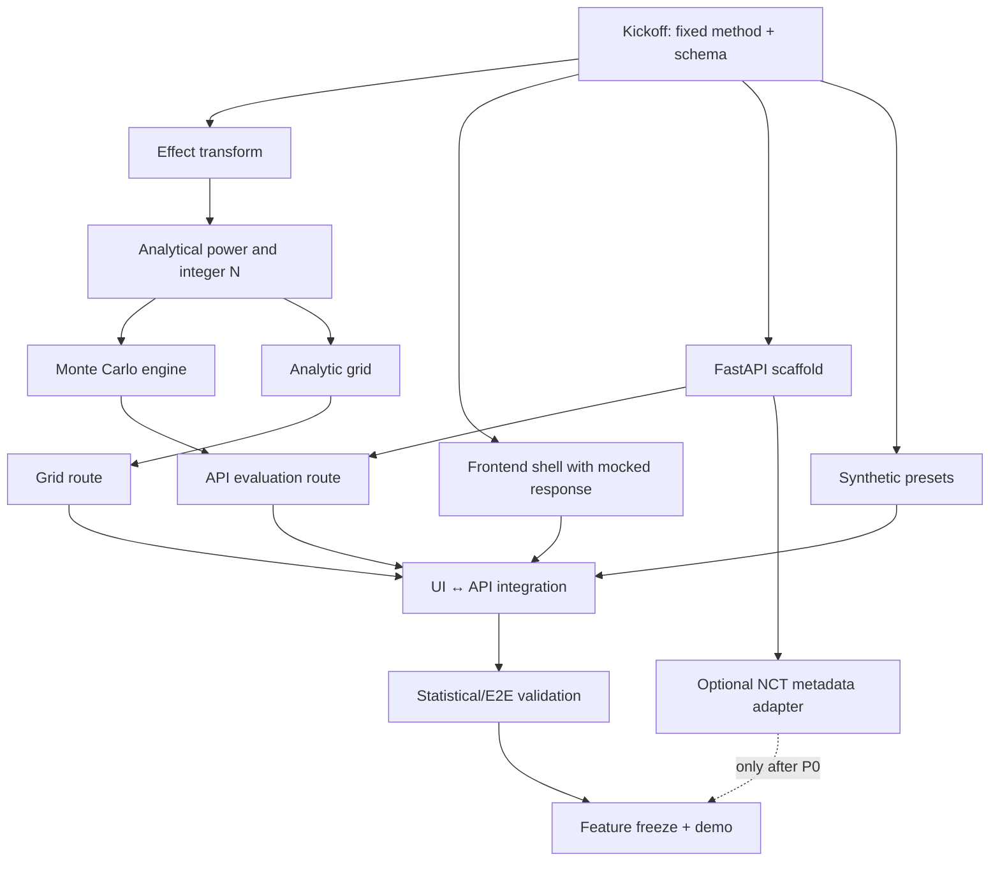

# Baseline Breaker — Detailed Implementation Playbook

**Document:** `03_IMPLEMENTATION_PLAYBOOK.md`  
**Version:** 1.0, 10 October 2026  
**Companions:** [`01_BASELINE_BREAKER_SPEC.md`](01_BASELINE_BREAKER_SPEC.md) · [`02_INFRASTRUCTURE_ARCHITECTURE.md`](02_INFRASTRUCTURE_ARCHITECTURE.md)  
**Audience:** four-person HackRU implementation team and coding agents. This is a sequence of executable engineering tasks, **not** a report on an already implemented system.

> **Deliver one complete experience:** enter a binary two-arm trial's planning assumptions → calculate an evaluable and enrolled N → freeze N → perturb baseline/dropout → show analytic power and the 80% boundary → verify a point by seeded Monte Carlo → export reproducible results. Public NCT import should never be allowed to block this path.

## 0. Read this before starting

### Decisions that must not drift

1. **Clinical baseline ≠ general-population disease prevalence.** The modeled parameter is control-arm endpoint risk among eligible participants over a stated follow-up period.
2. **Trial design is separate from the stress scenario.** Recomputing N every time the stress baseline changes invalidates the point of the visualization.
3. **Canonical planning method:** Cohen's-h/NormalIndPower two-sided normal approximation. Alternative common methods may return different N; label them if shown.
4. **Canonical simulation:** independently retained binomial arm counts, pooled two-proportion z-test. Show two-sided rejection and favorable-direction rejection separately.
5. **No automatic treatment-effect discovery.** Treatment benefit is hypothetical. If effects are uncertain, explore explicit scenarios; never infer biological truth.
6. **Never label simulated significance as drug approval, real clinical success, or probability of market success.**
7. **No patient data or PHI.** Public study metadata and synthetic patient outcomes only.

### Numeric test fixture (agreed before coding)

```yaml
preset: baseline-collapse-v1
p_control_planned: 0.20
relative_risk: 0.75
p_treatment_planned: 0.15
alpha: 0.05
target_power: 0.80
allocation_ratio: 1.0
# For the clean N/power demo, start with no dropout:
dropout_control: 0.0
dropout_treatment: 0.0
expected_n_evaluable_per_arm: 903  # Cohen's-h/NormalIndPower method
stress_control_risk: 0.10
stress_treatment_risk: 0.075
expected_stress_power_at_n_903: approximately 0.470
replicates: 10000
seed: 42
```

The research report's `906/arm` comes from another common two-proportion formula. **Do not silently swap the two methods**. With 10% *planned* dropout, approximately `1,004` enrolled per arm gives 903 expected evaluable per arm; use a separate preset if highlighting dropout.

### Completion definition

**P0 is complete only when all of the following are true:** (a) numerical reference fixture passes, (b) analytic and simulation inputs are visibly versioned, (c) stress sliders preserve planned N, (d) live selected-cell Monte Carlo works with a fixed seed and error estimate, (e) a heatmap clearly separates invalid scenarios, (f) offline synthetic demo works after disabling network, and (g) a clear scientific disclaimer is visible.

## 1. Team roles, branches, and parallel execution

| Owner | Branch | Modules | Deliverable by hour 6 |
|---|---|---|---|
| **A — Statistical engine** | `feat/statistical-core` | `backend/app/statistics/*`, `test_effect.py`, `test_sample_size.py` | Validated 903-per-arm reference and reusable power/simulation functions |
| **B — API and external data** | `feat/api-and-trials` | `schemas.py`, `main.py`, `routers/*`, `data/*`, Docker | Running typed FastAPI with stubbed design/grid routes |
| **C — Frontend and charts** | `feat/frontend-visuals` | Next.js `components/*`, `lib/*`, CSS | Clickable desktop dashboard with local mock responses |
| **D — Integration, quality, demo** | `feat/integration-demo` | `demo-data/*`, E2E test, CI, docs/demo, export | Seeded presets, walkthrough, contract smoke tests |

**No person is “just doing research.”** Ask a teammate to review statistical assumptions, but all four should ship code. Set up a shared Discord/issue board, commit small increments, and agree that B owns contract changes while A validates numeric meanings and C owns presentation types.

### One-time kickoff (first 60–90 minutes)

- [ ] Choose Python 3.12 and a Node LTS available on all development machines; write versions to README.
- [ ] Scaffold `backend/` and `frontend/`, README commands, `.env.example`, `.gitignore`.
- [ ] Agree the canonical JSON fields from `02_INFRASTRUCTURE_ARCHITECTURE.md`.
- [ ] Agree the demo fixture and method versions from above.
- [ ] Assign one lead responsible for keeping `main` releasable.
- [ ] Create empty API endpoints with fixture responses; C can immediately integrate against mocks.
- [ ] Create a GitHub milestone containing P0 issues with owners and tests.

**Go/no-go at hour 2:** If the shared request/response schema has not been frozen, stop working on new features and resolve it first.

---

## 2. Section A — Statistical inputs, schemas and effect transformation

**Owner:** A (logic), B (API type binding)  
**Files:** `backend/app/statistics/effect.py`, `backend/app/schemas.py`, `frontend/lib/contracts.ts`

### Implementation steps

1. Define `TrialAssumptions`, `Effect`, `Dropout`, `FixedEnrollment`, `StressScenario`, `SimulationOptions` using Pydantic v2 models or discriminated unions.
2. Keep probability units as **fractions**, not percentages. The UI can display `20%`, but the backend always receives `0.20`.
3. Implement `resolve_treatment_risk(p_control, effect)`:
   - RR mode: `p_t = p_control * effect.value`.
   - ARR mode: `p_t = p_control - effect.value`.
   - Reject `p_t <= 0` or `p_t >= 1` for the MVP normal-power method.
4. Validate lower-is-better scope: RR must be in `(0,1)`; ARR in `(0,p_control)`.
5. Preserve an immutable `planned_design` and separate `stress_scenario` structure; the API must require explicit fixed enrollment when evaluating a stress scenario.
6. Implement a **source tag** for every imported/planned field (`manual_user`, `synthetic_preset`, `protocol_curated`, `clinicaltrials_registry`).
7. Create unit tests for exact conversions, rejected invalid values, RR vs ARR divergence, and no implicit percent/fraction conversion.

### Runnable core example: `effect.py`

```python
from dataclasses import dataclass
from typing import Literal

EffectKind = Literal["relative_risk", "absolute_risk_reduction"]

@dataclass(frozen=True)
class Effect:
    kind: EffectKind
    value: float

def treatment_risk(p_control: float, effect: Effect) -> float:
    if not 0.0 < p_control < 1.0:
        raise ValueError("p_control must be in (0, 1)")
    if effect.kind == "relative_risk":
        if not 0.0 < effect.value < 1.0:
            raise ValueError("RR must be in (0, 1) for lower-is-better MVP")
        p_treatment = p_control * effect.value
    elif effect.kind == "absolute_risk_reduction":
        if not 0.0 < effect.value < p_control:
            raise ValueError("ARR must be in (0, p_control)")
        p_treatment = p_control - effect.value
    else:
        raise ValueError("Unsupported effect type")
    if not 0.0 < p_treatment < 1.0:
        raise ValueError("Derived treatment risk out of bounds")
    return p_treatment
```

### Acceptance tests

```python
import pytest

assert treatment_risk(.2, Effect("relative_risk", .75)) == pytest.approx(.15)
assert treatment_risk(.2, Effect("absolute_risk_reduction", .05)) == pytest.approx(.15)
# ARR=.05 is invalid if p_control=.04; show invalid cell rather than zero power.
```

Prefer `pytest.approx` for floating comparisons in real tests. Verify Pydantic errors become 422 responses with stable field names.

**Done when:** RR and ARR inputs cannot produce impossible probabilities; the same typed contract is enforced by frontend and backend.

---

## 3. Section B — Analytical power and integer sample-size solver

**Owner:** A  
**Files:** `statistics/analytic.py`, `statistics/sample_size.py`, `tests/test_sample_size.py`

### Steps

1. Define `analytic_power(p_control, p_treatment, n_control_evaluable, n_treatment_evaluable, alpha, method='cohen_h_normal_v1')`.
2. Use `statsmodels.stats.proportion.proportion_effectsize` for the Cohen's h transform and `statsmodels.stats.power.NormalIndPower().power` to verify your formula.
3. For shipped equal allocation, search only integer equal evaluable arm sizes. If unequal ratio is not validated, reject rather than promising it.
4. Implement exponential bracketing: test n=2,4,8,… until power meets target; cap N at a documented maximum.
5. Implement integer binary search for **smallest n** meeting target power; check `power(n-1) < target <= power(n)`.
6. Convert evaluable to enrolled N using separate dropout rates (`ceil(n/(1-d))`); return *both*.
7. Store method version, effect transformation and all values in result.
8. Independently test benchmark scenarios against statsmodels; document alternate formula discrepancies.

### Reference implementation sketch

```python
import math
from statsmodels.stats.power import NormalIndPower
from statsmodels.stats.proportion import proportion_effectsize

POWER = NormalIndPower()
MAX_EVALUABLE_PER_ARM = 1_000_000

def cohen_h_power(p_control: float, p_treatment: float,
                  n_per_arm: int, alpha: float = .05) -> float:
    h = abs(proportion_effectsize(p_control, p_treatment))
    return float(POWER.power(
        effect_size=h, nobs1=n_per_arm, alpha=alpha,
        ratio=1.0, alternative="two-sided"
    ))

def minimum_n_per_arm(p_control: float, p_treatment: float,
                      target: float = .8, alpha: float = .05) -> int:
    if p_control == p_treatment:
        raise ValueError("No finite N for null effect at a target above alpha")
    if not 0 < alpha < 1 or not 0 < target < 1:
        raise ValueError("Invalid alpha/target")
    low, high = 2, 2
    while cohen_h_power(p_control, p_treatment, high, alpha) < target:
        low = high + 1
        high *= 2
        if high > MAX_EVALUABLE_PER_ARM:
            raise ValueError("REQUIRED_N_EXCEEDS_LIMIT")
    while low < high:
        mid = (low + high) // 2
        if cohen_h_power(p_control, p_treatment, mid, alpha) >= target:
            high = mid
        else:
            low = mid + 1
    return low

def inflated_enrollment(evaluable: int, dropout: float) -> int:
    if not 0 <= dropout < 1:
        raise ValueError("Invalid dropout")
    return math.ceil(evaluable / (1 - dropout))
```

**Code-review note:** at extreme probabilities and small sample sizes, normal approximations can misbehave; the MVP should **warn or reject unsupported extremes**. The code sketch demonstrates algorithm structure, not an FDA-approved sample-size calculation. If `target <= alpha`, the n-search interpretation changes; reject that combination in the MVP validation layer.

### Required tests

- `pC=.20, pT=.15, target=.80, alpha=.05 → n=903 per arm` (canonical statsmodels method in verified environment).
- `n=903, pC=.10, pT=.075 → power ≈ .470`.
- `dropout=.10 and evaluable=903 → enrolled=1004`.
- Monotonicity: increasing evaluable N should not reduce computed power.
- At fixed control rate, smaller effect should require larger N.
- Integer minimality: n meets target and n−1 does not.
- Tests for invalid alpha, RR, ARR, huge N, probabilities too near boundaries.
- Cross-check same `h,n,alpha` against `NormalIndPower()` exactly or within machine tolerance.

**Done when:** sample-size method is fully described in `docs/STATISTICAL_METHODS.md`, and benchmark tests pass without hardcoding output in application logic.

---

## 4. Section C — Vectorized Monte Carlo simulation

**Owner:** A; B supplies route/cap  
**Files:** `statistics/simulation.py`, `tests/test_simulation.py`

### Model and implementation steps

1. Receive *fixed enrolled N* for each arm, true hypothetical `pC`, `pT`, `dC`, `dT`, alpha, seed, and replicates.
2. Initialize `numpy.random.default_rng(seed)`; return seed with results.
3. Draw **retained counts** using binomial dropout, independently by arm.
4. Draw **event counts** conditional on retained counts, using binomial endpoint probability.
5. Compute estimated arm rates, pooled event probability, standard error, z-statistic, and two-sided p-values **using vectorized arrays**.
6. Identify invalid-test replicates (zero retained count, zero pooled variance, numerical nonfinite values); use a documented conservative `nonrejection` treatment and report their percentage.
7. Return:
   - two-sided-significance fraction;
   - significant-and-favorable fraction;
   - MCSE for each fraction;
   - invalid-test fraction;
   - mean retained subjects and events by arm;
   - optional compact histogram bins rather than raw 10k values;
   - seed, reps, model/version, warnings.
8. Fix default 10,000 replications, max 100,000, and an allocation/CPU guard.

### Numerical implementation skeleton

```python
import numpy as np
from scipy.stats import norm

def simulate_binary(n_c: int, n_t: int,
                    p_c: float, p_t: float,
                    d_c: float, d_t: float,
                    alpha: float = .05,
                    reps: int = 10_000,
                    seed: int = 42) -> dict:
    if not 1 <= reps <= 100_000:
        raise ValueError("Replicate count outside allowed range")
    rng = np.random.default_rng(seed)
    r_c = rng.binomial(n_c, 1 - d_c, size=reps)
    r_t = rng.binomial(n_t, 1 - d_t, size=reps)
    x_c = rng.binomial(r_c, p_c)
    x_t = rng.binomial(r_t, p_t)

    # Safe division avoids propagation of NaNs for a zero-retained arm.
    pc_hat = np.divide(x_c, r_c, out=np.zeros(reps), where=r_c > 0)
    pt_hat = np.divide(x_t, r_t, out=np.zeros(reps), where=r_t > 0)
    pooled = np.divide(x_c + x_t, r_c + r_t,
                       out=np.zeros(reps), where=(r_c + r_t) > 0)
    inv_rc = np.divide(1.0, r_c, out=np.zeros(reps), where=r_c > 0)
    inv_rt = np.divide(1.0, r_t, out=np.zeros(reps), where=r_t > 0)
    se = np.sqrt(pooled * (1 - pooled) * (inv_rc + inv_rt))

    valid = (r_c > 0) & (r_t > 0) & (se > 0) & np.isfinite(se)
    z = np.divide(pt_hat - pc_hat, se,
                  out=np.zeros(reps, dtype=float), where=valid)
    pvals = np.ones(reps, dtype=float)
    pvals[valid] = 2 * norm.sf(np.abs(z[valid]))
    reject_two = valid & (pvals < alpha)
    reject_favorable = reject_two & (pt_hat < pc_hat)

    fraction = float(reject_two.mean())
    favorable = float(reject_favorable.mean())
    mcse = float(np.sqrt(fraction * (1 - fraction) / reps))
    return {
        "significant_two_sided_fraction": fraction,
        "significant_favorable_fraction": favorable,
        "mcse": mcse,
        "invalid_test_fraction": float((~valid).mean()),
        "mean_retained_control": float(r_c.mean()),
        "mean_retained_treatment": float(r_t.mean()),
        "mean_control_events": float(x_c.mean()),
        "mean_treatment_events": float(x_t.mean()),
        "replicates": reps,
        "seed": seed,
        "method": "pooled_two_proportion_z_v1",
    }
```

**Clinical/method limitation:** setting undefined z tests to `nonrejection` is a conservative implementation policy, *not* a claim that a pooled z test is appropriate for low event counts. A future Fisher exact mode must have separate validation and clearly labeled power behavior.

### Simulation validation protocol

- **Moments:** retained sample mean within ~4 standard errors of `N(1-d)`; event counts within their binomial expectation (allow finite MC error).
- **Same seed:** byte-for-byte same JSON except timestamp if input/env unchanged.
- **Null size:** with `p_c=p_t=.20` and sufficiently large N, two-sided rejection fraction ≈ alpha; favorable-direction rejection ≈ alpha/2. *Do not mistakenly demand favorable fraction ≈ alpha.*
- **Alternative:** simulated two-sided power near its paired analytic benchmark, accounting for MCSE and differing approximate tests.
- **Replicate convergence:** standard error decreases roughly as `1/sqrt(reps)`; do not assert every individual batch is closer to the truth than the previous one.
- **Unbalanced/edge values:** invalid tests are caught; no NaNs in JSON.
- **No event rate prediction:** assert dashboard labels remain conditional-on-assumptions.

### Performance improvement order

1. Vectorize NumPy first.
2. Return aggregates, not 10,000 raw trial objects.
3. Cache identical parameter/seed requests.
4. Benchmark selected scenario (median and p95 latency).
5. If excessive latency, lower default reps to 5,000 while keeping the MCSE label; add an explicit “Refine” button.
6. Only after profiling: bounded process worker / task queue.

**Done when:** selected-cell simulation is reliable, reproducible, numerically tested, and fast enough on the actual demo laptop.

---

## 5. Section D — Stress grid, power curve and Assumption Safety Envelope

**Owner:** A supplies numerical functions, B assembles endpoint, C visualizes  
**Files:** `statistics/stress_grid.py`, `routers/calculations.py`, `components/StressHeatmap.tsx`

### Implementation steps

1. Freeze `enrolled_n` obtained from initial design calculation.
2. Generate a sorted baseline array e.g. `np.linspace(0.05, 0.30, 31)` and dropout array `np.linspace(0, 0.30, 21)`.
3. For each baseline, derive `p_t` from **selected** relative or absolute effect model; invalid ARR cells → `null` with invalid mask.
4. For each dropout, compute **expected evaluable N**, floored to an integer and clearly marked as an approximation.
5. Evaluate Cohen's-h conditional analytic power; return grid with dimensions **[dropout][baseline]** and associated method metadata.
6. Calculate `mask = power >= target`; interpolate a boundary only where cells on opposite sides of the target have valid numerical values.
7. Return planned point, stress point, worst-case value over grid domain, and invalid-cell count.
8. For a selected cell, run `/scenarios/evaluate` with full Monte Carlo; overlay its result and MCSE (not fake exact simulation of the whole grid).
9. Cache identical heatmaps by canonical input hash; debounce UI requests by ~150–300 ms and cancel outdated fetches.

### Key design choice: heatmap semantics

The P0 grid is **not** a Monte Carlo grid. Name its legend “Approximate conditional power at expected retained counts.” Only selected-point Monte Carlo is stochastic; label it separately. This avoids a potentially slow 31×21×10k run every slider move.

### Suggested pure function

```python
import math

def stress_grid(fixed_enrolled_n: int,
                effect: Effect,
                baselines: list[float],
                dropout_rates: list[float],
                alpha: float,
                target_power: float):
    # Validate and cap lengths before allocations.
    matrix = []
    for dropout in dropout_rates:
        expected_n = math.floor(fixed_enrolled_n * (1 - dropout))
        if expected_n < 2:
            matrix.append([None] * len(baselines))
            continue
        row = []
        for p_c in baselines:
            try:
                p_t = treatment_risk(p_c, effect)
                row.append(cohen_h_power(p_c, p_t, expected_n, alpha))
            except ValueError:
                row.append(None)  # invalid model point, NOT 0 power
        matrix.append(row)
    return matrix
```

Later support separate arm sample sizes and dropouts; start with symmetric stress dropout and equal-arm enrollment to keep P0 auditable.

### Required plots

**Power curve:** x = hypothetical true control event rate; y = analytic conditional power; horizontal dashed target; markers for planning and selected stress baselines.

**Heatmap:** x = baseline; y = assumed dropout; z = analytic conditional power; invalid cells hatched/gray; overlay an 80% contour and current point.

**Comparison panel:** planning N, stress N (unchanged), planned power, selected power, change in percentage points, method labels.

### Acceptance criteria

- Heatmap orientation and dimensions validated with a small 2×3 fixture.
- Clicking one cell generates a simulation for that exact baseline/dropout and the **frozen** enrollment.
- Changing ARR/RR explicitly changes grid model; no stale chart mixes models.
- Displayed minimum/maximum depend only on current grid domain, not universal conditions.
- Invalid ARR combinations are visually distinct from low-power cells.
- Slow/upstream errors show previous valid result as **stale** rather than silently relabeling it current.

**Done when:** an evaluator can identify the 80% contour and understand what caused the planned design to cross it.

---

## 6. Section E — Backend API, validation, caching and security

**Owner:** B  
**Files:** `main.py`, `schemas.py`, `routers/calculations.py`, `settings.py`, `cache.py`, `tests/test_api_contract.py`

### Implementation steps

1. Create the FastAPI app, health route, CORS allowlist, error handlers and Pydantic v2 request/response types.
2. Implement canonical endpoints from Infrastructure doc:
   - `POST /api/v1/design/calculate`
   - `POST /api/v1/scenarios/evaluate`
   - `POST /api/v1/scenarios/grid`
   - `GET /api/v1/trials/{nct_id}` (P1)
   - `GET /healthz`
   - `GET /api/v1/meta`
3. Keep API endpoint functions thin: validate → call pure service → serialize output → attach method/version/provenance/warnings.
4. Add structured error envelope and HTTP status mapping; return 422 for invalid ARR stress values.
5. Add hard caps for N, reps, grid points, and request size. No user-provided URLs.
6. Cache expensive identical requests using a bounded in-process cache keyed by canonical JSON + model version + seed.
7. Bench frontend roundtrip latency, not just raw NumPy time.
8. Add at least one API fixture and contract snapshot so frontend can proceed independently.

### Minimal FastAPI skeleton

```python
from fastapi import FastAPI
from fastapi.middleware.cors import CORSMiddleware
from pydantic import BaseModel, Field
from typing import Literal

app = FastAPI(title="Baseline Breaker API", version="1.0.0")
app.add_middleware(
    CORSMiddleware,
    allow_origins=["http://localhost:3000"],  # extend via environment
    allow_credentials=False,
    allow_methods=["GET", "POST"],
    allow_headers=["Content-Type"],
)

class EffectIn(BaseModel):
    kind: Literal["relative_risk", "absolute_risk_reduction"]
    value: float = Field(gt=0.0)

class DropoutIn(BaseModel):
    control: float = Field(ge=0.0, lt=1.0)
    treatment: float = Field(ge=0.0, lt=1.0)

class DesignIn(BaseModel):
    model_version: Literal["binary-v1"]
    control_event_rate: float = Field(gt=0.0, lt=1.0)
    effect: EffectIn
    alpha: float = Field(gt=0.0, lt=1.0)
    target_power: float = Field(gt=0.0, lt=1.0)
    allocation_ratio: float = Field(default=1.0, gt=0.0)
    dropout: DropoutIn

@app.get("/healthz")
def healthz():
    return {"status": "ok", "model_version": "binary-v1"}

@app.post("/api/v1/design/calculate")
def calculate_design(data: DesignIn):
    # TODO: cross-field validate effect vs p_control,
    # reject unsupported allocation_ratio, then call pure stat service.
    # TODO: return validated response schema, not arbitrary raw dict.
    raise NotImplementedError("Wire to calculation service")
```

This code is an API scaffold, **not yet a working calculation route**. During implementation, define response models; replace the TODO with the Section B functions and use custom domain exceptions mapped to 422/422-like errors, rather than shipping the intentional `NotImplementedError`.

### Contract checks

- Snapshot `/openapi.json` into `contracts/openapi.snapshot.json` after schema freeze.
- Compare normalized backend output to TypeScript contract. If no code generation, maintain a small manually reviewed `contracts.ts` matching the canonical JSON.
- Invalid NCT ID rejected before any HTTP request.
- No raw exceptions or stack traces returned to browser.
- Requests exceeding resource limits rejected before allocating large NumPy arrays.

**Done when:** frontend's mocked contract can be replaced with real API calls without renaming fields.

---

## 7. Section F — ClinicalTrials.gov import and curated trial example

**Owner:** B primary, D QA  
**Files:** `data/clinicaltrials.py`, `data/normalize.py`, `routers/trials.py`, `demo-data/curated-study.json`

**Priority:** P1, not a P0 blocker.

### Steps

1. Validate NCT format strictly: `NCT` + eight digits.
2. Call the official API `GET https://clinicaltrials.gov/api/v2/studies/{NCT_ID}` via an allowlisted, fixed backend base URL with timeout and error handling.
3. Extract identification, study design, arms/interventions, primary outcome name/time frame, eligibility text, optional posted results.
4. Normalize to a small typed response; preserve source URL and retrieval time.
5. Set `planned_control_event_rate` and `effect_value` to **null** unless explicitly sourced and manually entered from a protocol/SAP.
6. For one curated study, read the actual public protocol/SAP/sample-size section. Store exact source link, page or section, assumption text, and a flag `verified_manually`.
7. Frontend prepopulates safely only fields known from the record, then asks the user to confirm planning assumptions.
8. Cache metadata in memory and bundle a fixture in Git. Offline failure must not disable manual mode.

### Suggested UI copy

> “Registry information loaded. We found the study design and outcome description, but could not verify the original control-arm event-rate assumption. Enter a value from the protocol or choose a synthetic example.”

### Data quality tests

- Fetch known NCT fixture with posted results and one without (record exact IDs once selected).
- Handle optional or missing `resultsSection`, multiple outcomes, absent masking, unusual phase values.
- Handle API 404, timeout, malformed upstream response, status 429/5xx.
- No value ever silently switches provenance from `actual_posted_result` to `planned_assumption`.

**Done when:** import enhances credibility and cannot create a scientifically invalid initial design by guessing.

---

## 8. Section G — Frontend experience and visual components

**Owner:** C; D validates demo flow  
**Files:** `frontend/app/page.tsx`, `components/*`, `lib/api.ts`, `lib/contracts.ts`

### Screens and components

| Component | Inputs | Behavior | Validation |
|---|---|---|---|
| `DesignForm` | pC, effect kind/value, alpha, power target, dropout | Validate fractions/percent display; “Calculate design” | Range, invalid ARR, non-null outputs |
| `DesignSummary` | eval/enroll N, planned power | Show method + separate sample types | No false precision |
| `StressControls` | stress baseline, dropout | Modify scenario **without changing fixed planned N** | Immutable frozen design |
| `PowerCurve` | baseline array, analytic power | Plot planned/stress markers and target line | Axes, legend, units |
| `StressHeatmap` | baseline, dropout, power matrix, invalid mask | Highlight selected point/80% contour | Correct orientation and invalid shading |
| `MonteCarloPanel` | MC fractions, MCSE, seed, reps | Show two-sided vs favorable fractions | Different statistic labels |
| `ModelWarnings` | method, warnings, provenance | Explain assumptions and unsupported regions | Always visible near results |
| `PresetSwitcher` | 3 bundled scenarios | Deterministic one-click demo | Synthetic badges |
| `ScenarioExport` | full input/result metadata | Download JSON | Re-import/replay valid |
| `NctImport` (P1) | NCT ID | Optional metadata lookup | Manual mode unaffected on failure |

### State management rules

```typescript
interface WorkspaceState {
  plannedDraft: TrialAssumptions;
  calculatedDesign: DesignResult | null;
  lockedEnrollment: FixedEnrollment | null;
  stress: StressScenario;
  grid: StressGridResult | null;
  monteCarlo: SimulationResult | null;
  status: "idle" | "calculating" | "ready" | "error";
  displayedInputsHash: string | null;
}
```

1. User edits planned form → `plannedDraft` dirty flag; derived prior design shown as stale until recalculated.
2. User clicks Calculate → API computes and locks enrolled counts; initializes stress scenario.
3. User drags shock slider → only `stress` changes; previous results tagged stale while new analytic grid loads.
4. User releases slider → request selected-cell Monte Carlo with fixed enrollment, seed, and reps.
5. User chooses RR vs ARR in **stress** only when explicitly supported; surface invalid cells.
6. User clicks Recalculate Design → a **new design**, not mutation of the historical baseline comparison.

### Browser integration snippet

```typescript
export async function postJson<TReq, TResp>(path: string, body: TReq): Promise<TResp> {
  const url = `${process.env.NEXT_PUBLIC_API_BASE_URL}${path}`;
  const response = await fetch(url, {
    method: "POST",
    headers: { "Content-Type": "application/json" },
    body: JSON.stringify(body),
  });
  if (!response.ok) {
    const detail = await response.json().catch(() => null);
    throw new Error(detail?.error?.message ?? `Request failed: ${response.status}`);
  }
  return (await response.json()) as TResp;
}
```

Use `AbortController` and a monotonically increasing request token or request key in the actual component so older slower results cannot overwrite newer slider inputs. Avoid copying statistical formulas into TS; let the backend own computation.

### Accessibility / UX polish

- Input tooltips distinguish risk **probability** from general-population prevalence.
- Red must not be the only indicator of under-target power; use pattern/border/numeric label.
- Provide a data-table or export path for readers who cannot interact with heatmap colors.
- Show percentages as `80.0%`, changes as `−33.0 percentage points`, and counts as integers.
- Show `Seed 42 · 10,000 simulations · pooled-z MC` near the simulation result.
- Avoid “Trial will fail” or “Make N this large”; prefer “Estimated conditional power under the specified model.”

**Done when:** judge can run scenario, change baseline, understand why power changes and compare planned vs stressed assumptions in under 90 seconds.

---

## 9. Section H — Synthetic presets, reproducibility and export

**Owner:** D  
**Files:** `demo-data/*.json`, `docs/ASSUMPTION_PROVENANCE.md`, `components/ScenarioExport.tsx`

### Required presets

**A. Baseline Collapse**

- Planned `pC=0.20`, RR `0.75`, desired power `.80`, alpha `.05`, no dropout.
- Design N=903 evaluable/enrolled per arm by chosen analytical method.
- Shock `pC=0.10` with RR still `.75`; two-sided analytic power about 47%.
- Display loss in percentage points, subject to exact method and rounding.

**B. Attrition Shock**

- Planned `pC=.20`, RR `.75`, dropout `5%`, enrollment based on that.
- Shock dropout `25%` with fixed enrolled N.
- Show effect of fewer expected retained outcomes and selected-cell Monte Carlo.

**C. Stable Design**

- Planned `pC=.20`, RR `.75`, assumed dropout `5%`.
- Shock baseline `.19` and dropout `6%`.
- Show relatively modest difference and why baseline uncertainty should be evaluated, not sensationalized.

### Export artifact schema

```json
{
  "export_schema_version": 1,
  "project": "Baseline Breaker",
  "scenario_origin": "synthetic_preset",
  "preset_id": "baseline-collapse-v1",
  "model_version": "binary-v1",
  "planned_design": {"...": "see versioned TrialAssumptions schema"},
  "fixed_enrollment": {"control": 903, "treatment": 903},
  "stress_scenario": {"...": "see versioned StressScenario schema"},
  "analytic": {"method": "cohen_h_normal_v1"},
  "monte_carlo": {"method": "pooled_two_proportion_z_v1", "seed": 42, "replicates": 10000},
  "source_links": [],
  "warnings": ["Synthetic example; not a clinical recommendation"],
  "generated_at": "<ISO-8601 timestamp>",
  "inputs_hash": "<sha256>"
}
```

Ellipses/placeholders denote fields to serialize fully from the actual schema. Export the complete inputs and results rather than only summaries; allow technical reviewers to reproduce a run.

**Done when:** offline demo can proceed from preset load to numeric charts and export with no registry access.

---

## 10. Section I — Statistical QA, automated tests and scientific guardrails

**Owner:** D coordinates; A owns numerical scientific review; everyone fixes own failures.

### Must-pass testing matrix

| Test group | Concrete cases | Pass condition |
|---|---|---|
| Unit conversions | `.20 × .75 = .15`, ARR .05 → .15 | Float approximate equality; impossible ARR rejected |
| Planning N | Reference fixture `.20/.15` | 903 evaluable/arm under canonical arcsine method |
| Integer minimality | N=903 vs 902 | N=903 meets `.80`, N=902 below `.80` at chosen alpha |
| Baseline shock | fixed 903/arm, `.10/.075` | analytic conditional power ~.470 |
| Dropout | 10% | enrolled=1004 for target evaluable=903 |
| Null MC | `pC=pT=.20` | two-sided false-positive fraction near .05, favorable near .025 within MC tolerance |
| Alternative MC | `.20/.15` 903/arm | simulation aligns reasonably with analytic method after accounting for approximation + MCSE |
| Seed | same inputs/seed | same numeric JSON payload independent of timestamp |
| Grid shape | 3 baseline × 2 dropout | shape 2 rows × 3 columns, correct array ordering |
| Invalid ARR | pC < fixed ARR | null/invalid mask; never power=0 fallback |
| Empty/rare events | valid counts insufficient | no NaN/inf; warning and invalid fraction returned |
| API | valid requests, malformed body | typed responses or structured 422 errors |
| CTG adapter | absent results/timeout | nonfatal error, synthetic demo still works |
| E2E | full baseline-shock workflow | planned N stays fixed and power chart updates |
| Offline | disconnect network | synthetic preset and calculations still complete |

### Test guidance

- For simulated proportions, use tolerances derived from Monte Carlo SE (e.g., `4 × MCSE`) and include an allowance for analytical test-method differences.
- For two-sided null size, treat `p < alpha` as **two-sided**, not “significant and beneficial”; expect ~alpha/2 for favorable-only null rejections.
- If severe rare-event/small-cell warning triggers, do not compare pooled-z simulation to an approximation as though either were definitively validated.
- Have a domain expert review the claimed interpretation separately from code correctness.
- Validate every numeric label, particularly “evaluable,” “enrolled,” “conditional power,” “MCSE,” and “favorable significance.”

### Security and ethical review

- Reject all inputs that imply use of identifiable patient records.
- Confirm no login, tokens, API keys, or uploads required in the demo.
- Confirm no LLM outputs portrayed as verified trial evidence.
- Confirm no presentation of results as sponsor-specific enrollment advice or FDA-compliant protocol output.
- Confirm trial registries and articles are linked for curated examples.

---

## 11. Section J — Infrastructure, CI, deploy and operational fallback

**Owner:** B deployment; D CI and recovery  
**Files:** `backend/Dockerfile`, `.github/workflows/ci.yml`, `compose.yaml`, `.env.example`

### Step-by-step

1. Containerize backend early with a health route. Pin dependency versions and ensure import/package paths resolve.
2. Run `pytest -q` and smoke test `/healthz` inside the image.
3. Deploy API to one lightweight CPU host; disable expensive endpoints or cap rate/concurrency if free-tier limits are hit.
4. Deploy frontend to Vercel or host both services locally; configure `NEXT_PUBLIC_API_BASE_URL` to point to reachable HTTPS API in deployed build.
5. Set backend CORS allowlist to real frontend origin and localhost development origin.
6. Test the actual browser on the actual judging laptop/phone; don't rely on `curl` alone.
7. Precompute/cache synthetic preset responses for offline fallback; verify frontend has a clear “local demo” option.
8. Tag a stable `demo-ready` Git commit and record screen capture of the full flow.
9. Implement basic latency logging; measure, do not invent, response-time claims.

### CI smoke checks

```bash
# Backend
cd backend
pytest -q

# Frontend
cd frontend
npm ci
npm run lint
npm run build

# Container (from repo root)
docker build -t baseline-breaker-api ./backend
```

If Docker/image build is not compatible with a scaffold, correct project packaging rather than circumventing the test. Keep Python and Node version compatibility documented.

### Fallback matrix

| Failure | Fallback | What to demonstrate |
|---|---|---|
| ClinicalTrials.gov unavailable | Bundled synthetic presets | Main algorithm unaffected |
| Hosted Python server cold/unavailable | Run local backend + frontend | Live full feature set |
| Heatmap too slow | Smaller analytic grid, cached snapshot | Cause/effect still shown |
| MC too slow | 2k–5k reps plus visible MCSE; explicit refine | Correct uncertainty explanation |
| Stats model edge error | Validation warning and supported preset | Never display nonsense |
| UI chart library breaks | Raw numerical table, static fallback chart | Algorithm working and testable |

**Done when:** team can demonstrate the same scenario at a public URL and locally without external internet dependency.

---

## 12. Twenty-four-hour critical path and checkpoints

| Elapsed time | A — statistics | B — API/data | C — UI | D — integration/demo | Gate |
|---|---|---|---|---|---|
| **0–2 h** | Scope/method agreement | Schemas, API mocks | Page shell + mock data | Preset definitions, README | **G0** contracts frozen |
| **2–6 h** | Effect + analytic power + integer N tests | Live design endpoint, healthz, Docker start | Design/summary controls | Reference fixture checks and issue triage | **G1** 903/arm verified |
| **6–10 h** | Vectorized MC + MCSE | Evaluation endpoint/cache | Power curve + scenario controls | Contract and smoke tests | **G2** slider → real result |
| **10–14 h** | Stress grid + edge conditions | Grid route + rate caps | Heatmap, threshold line | Offline preset, integration | **G3** complete primary demo |
| **14–18 h** | Statistical review/test matrix | Optional NCT adapter | UI polish, warnings, export | Curate verified trial if time, rehearsal | **G4** P0 solid; P1 optional |
| **18–20 h** | Fix numerical bugs | Fix deployment/backend | Resolve UI defects | README, demo script, source links | **G5** feature freeze |
| **20–24 h** | Reverify numeric results | Production smoke test | Demo rehearsal | Record fallback and present | **G6** ready to judge |

### Hard stop rules

- **At 6 hours:** if statistical power/903 fixture is not passing, everyone prioritizes the core computation and API. No NCT import.
- **At 10 hours:** if no end-to-end slider works, freeze all new functionality and integrate.
- **At 14 hours:** if heatmap is incomplete, ship a power curve with exact scenario comparison first; make heatmap the remaining P0 priority.
- **At 18 hours:** if not all required P0 features work, delete stretch work, use preset-only mode, and focus on tests/accuracy.
- **At 20 hours:** no new features; fix bugs, rehearse, and tag release.

### Dependency graph



---

## 13. Demo script (90–120 seconds, reproducible)

**0:00–0:15 — The problem:** “Researchers calculate trial size from assumptions. What happens when one of those assumptions is wrong?” Load **Baseline Collapse**, explicitly synthetic.

**0:15–0:35 — Planned design:** Show `p_control=20%`, RR `0.75`, target 80%, `903 evaluable/arm` with the selected Cohen's-h method and no dropout.

**0:35–0:55 — Shock:** Move true scenario baseline to 10%, keep treatment RR and enrolled N fixed; projected conditional power falls to ~47%. Explain **not** a drug failure forecast.

**0:55–1:15 — Evidence:** Reveal heatmap and 80%-power frontier; show the robustness region shrinking as dropout increases.

**1:15–1:35 — Monte Carlo:** Run seeded 10k simulated trials, show estimated two-sided rejection rate and MCSE; point out slight difference between analytic and pooled-z MC methods.

**1:35–1:50 — Credibility:** Show input provenance, assumptions and export/replay. “No guessing patient eligibility or medical costs; this is prospective stress testing.”

**Closing:** “Traditional calculations tell you how a trial performs if assumptions are correct. Baseline Breaker visualizes the consequences when those assumptions change.”

### Likely judge questions — concise, correct answers

**“Why not just use an ordinary calculator?”**  
An ordinary calculator solves one scenario. This prototype maps which combinations of baseline risk/retention keep a *fixed* design near its target, then validates selected points with Monte Carlo and provenance.

**“How do you know the expected baseline risk?”**  
We do not infer it from population prevalence. It must be an assumption from prior compatible studies/protocol knowledge or manually entered, with uncertainty explored rather than hidden.

**“Does your tool say the trial will work?”**  
No. It reports conditional power under a specified effect and model, not biological efficacy, recruitment success, or FDA approval.

**“What if patients who drop out are systematically different?”**  
The MVP assumes outcome-independent missingness; outcome-dependent missingness and estimands require richer models. We surface that limitation, not a false answer.

**“Is your method equivalent to regulatory guidance?”**  
No. It is an exploratory educational/research planning prototype for one binary endpoint design, not a substitute for a statistician or sponsor protocol review.

---

## 14. Scope protection, extension order, and resume metrics

### Shipping priority

**P0:** design power solver, fixed-N stress, seeded Monte Carlo, analytic grid, curve, controls, three synthetic presets, warnings, tests, reproducible export.  
**P1:** optional NCT metadata, one manually verified protocol source, analytic-vs-MC explanation, deployed public link.  
**P2:** Beta uncertainty/assurance with explicit priors, robust-N optimization, scenario weighting, optional Fisher exact.  
**Post-event:** survival endpoints, clustered/stratified RCTs, intercurrent events, outcome-dependent missingness, adaptive designs, protocol extraction (human-confirmed).

### Metrics worth collecting after implementation

- Median/p95 runtime of 10k-vectorized MC on stated hardware.
- Maximum grid size completed within target UI latency on actual machine.
- Cross-checked reference fixtures passing and coverage of numerical edge cases.
- Exact number of synthetic scenarios and test cases.
- Reproducibility of repeat runs with pinned environment and seed.
- CLI/container cold-start and E2E success rate across repeated rehearsals.

**Never fabricate improvement percentages, benchmark counts, or clinical claims on a resume.** Good bullet structure after completion:

> Built a reproducible clinical-trial assumption stress tester using NumPy Monte Carlo simulation, validated two-proportion power calculations against statsmodels, and delivered interactive sensitivity maps through FastAPI and Next.js.

### Final handoff checklist

- [ ] P0 demo works offline, not dependent on NCT API or a cloud host.
- [ ] Readme: `npm ci`, Python install, API and UI launch, test commands.
- [ ] Source docs explain arcsine vs pooled-z method difference.
- [ ] Fixed-N shock demo uses correct frozen enrollment.
- [ ] Test fixture matches 903/arm and ≈47% stress-power reference.
- [ ] Null two-sided and favorable false-positive tests use different expected rates.
- [ ] Invalid models do not render fabricated zero-power cells.
- [ ] Every shown result records method/version, seed if simulated, and input provenance.
- [ ] One stable tagged commit, optional hosted link, recorded fallback demo.
- [ ] Judges can run a full scenario in under two minutes.

## 15. Authoritative reference list

- [FDA ICH E9(R1) — Estimands and sensitivity analysis](https://www.fda.gov/regulatory-information/search-fda-guidance-documents/e9r1-statistical-principles-clinical-trials-addendum-estimands-and-sensitivity-analysis-clinical)
- [ClinicalTrials.gov API v2 reference](https://clinicaltrials.gov/data-api/about-api)
- [NLM ClinicalTrials.gov v2 announcement](https://www.nlm.nih.gov/pubs/techbull/ma24/ma24_clinicaltrials_api.html)
- [statsmodels proportion_effectsize](https://www.statsmodels.org/stable/generated/statsmodels.stats.proportion.proportion_effectsize.html)
- [statsmodels NormalIndPower](https://www.statsmodels.org/stable/generated/statsmodels.stats.power.NormalIndPower.solve_power.html)
- [statsmodels proportions_ztest](https://www.statsmodels.org/stable/generated/statsmodels.stats.proportion.proportions_ztest.html)
- [NumPy generator/binomial](https://numpy.org/doc/stable/reference/random/generated/numpy.random.Generator.binomial.html)
- [SciPy normal survival function](https://docs.scipy.org/doc/scipy/reference/generated/scipy.stats.norm.html)
- [FastAPI concurrency](https://fastapi.tiangolo.com/async/)
- [Next.js deployment](https://nextjs.org/docs/app/getting-started/deploying)

---

**Engineering principle:** keep the math transparent, the originally planned enrollment fixed during sensitivity analysis, the distinction between conditional power and treatment efficacy unmistakable, and the entire demo reproducible with public or synthetic inputs.
